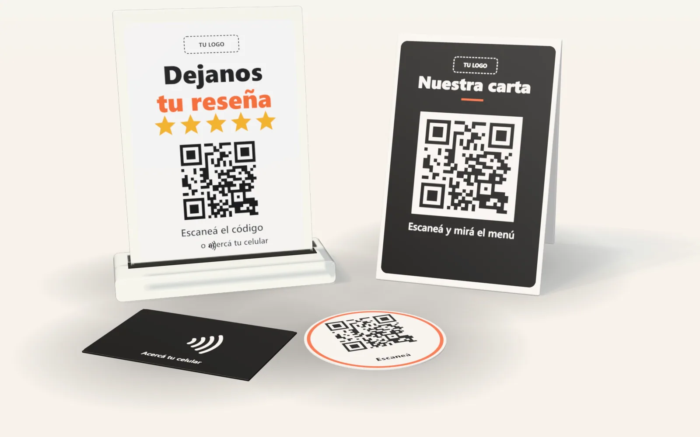

# AtajoLab Shop

**Tienda online de productos físicos personalizados con QR y NFC.**

Soportes para reseñas de Google, menús para restaurantes, tarjetas digitales, stickers y credenciales para eventos. Unidad comercial de [AtajoLab](https://atajolab.dev).

[](https://tienda.atajolab.dev)
[](https://nextjs.org/)
[](https://react.dev/)
[](https://www.typescriptlang.org/)
[](https://tailwindcss.com/)
[](https://pages.cloudflare.com/)

<p align="center">
  
</p>

<p align="center">
  <a href="https://tienda.atajolab.dev"><strong>Ver tienda en vivo</strong></a>
  ·
  <a href="https://atajolab.dev">AtajoLab</a>
  ·
  <a href="https://qr.atajolab.dev">Crear mi QR</a>
</p>

---

## Qué es

AtajoLab Shop es un **catálogo estático** pensado para vender productos físicos personalizados sin backend, sin pagos online y sin panel de administración.

El flujo es simple:

1. El visitante elige productos y los personaliza (nombre, enlace, cantidad).
2. Arma un pedido en el navegador (`localStorage`).
3. Envía la solicitud por **WhatsApp** con el mensaje ya armado.

Ideal para un negocio que cierra ventas por chat y quiere un escaparate rápido, liviano y fácil de mantener.

## Características

- Catálogo con búsqueda y filtros por categoría
- Fichas de producto con variantes, personalización y precios de referencia
- Pedido persistente en el navegador y mensaje listo para WhatsApp
- Temas **claro / oscuro / sistema** desde el header
- SEO básico: sitemap, robots, Open Graph y metadatos
- Sitio 100% estático, desplegable en Cloudflare Pages
- Tests unitarios (Vitest) y E2E + accesibilidad (Playwright + axe)
- Contenido y catálogo en archivos TypeScript (sin CMS)

### Categorías

| Categoría | Ejemplos |
| --- | --- |
| Reseñas de Google | Soportes y stickers QR / NFC |
| Menús para restaurantes y bares | Soportes de mesa, carteles |
| Eventos | Credenciales, identificadores, colgantes |
| Tarjetas digitales | Tarjetas QR y NFC de contacto |
| Stickers y etiquetas | Stickers QR/NFC, adhesivos |

## Tecnologías

| Área | Stack |
| --- | --- |
| Framework | **Next.js 16** (App Router) con `output: "export"` |
| UI | **React 19** + **Tailwind CSS 4** |
| Lenguaje | **TypeScript** estricto |
| Calidad | **ESLint**, **Vitest**, **Playwright** + **axe-core** |
| Hosting | **Cloudflare Pages** (HTML/CSS/JS estático en `out/`) |
| Pedidos | Enlaces `wa.me` generados en cliente |

Sin base de datos, sin API propia y sin autenticación de usuarios.

## Requisitos

- Node.js **20+** (recomendado 22; el repo incluye `.node-version`)
- npm

## Desarrollo local

```bash
npm install
cp .env.example .env.local   # opcional; el sitio ya funciona sin variables
npm run dev                  # http://localhost:3000
```

### Scripts

| Comando | Descripción |
| --- | --- |
| `npm run dev` | Servidor de desarrollo |
| `npm run build` | Build estático → `out/` |
| `npm run lint` | ESLint |
| `npm run typecheck` | Generación de tipos + `tsc` |
| `npm test` | Tests unitarios (Vitest) |
| `npm run test:e2e` | E2E + accesibilidad (Playwright) |
| `npm run check` | lint + typecheck + tests + build |
| `npm run deploy` | Build + deploy a Cloudflare Pages (`atajolab-shop`) |

Para E2E con Chromium descargado por Playwright:

```bash
npx playwright install chromium
PW_CHANNEL=chromium npm run test:e2e
```

## Variables de entorno

Todas son **opcionales**.

| Variable | Descripción |
| --- | --- |
| `NEXT_PUBLIC_WHATSAPP_NUMBER` | Reemplaza el número comercial. Solo dígitos, formato internacional (ej. `5493705204454`). Por defecto usa el de `src/data/site.ts`. |
| `NEXT_PUBLIC_SITE_URL` | URL pública (canonical, sitemap, Open Graph). Default: `https://tienda.atajolab.dev`. |
| `NEXT_PUBLIC_CONTACT_EMAIL` | Email de contacto adicional. |

Las variables `NEXT_PUBLIC_*` se incorporan en el **build**: si las cambiás, volvé a generar el sitio.

## Cómo funciona el negocio (resumen)

- **Pedidos por WhatsApp:** se abre `https://wa.me/<número>?text=...` con el texto listo; el cliente lo envía.
- **Por encargo, sin stock:** no hay inventario. El estado `proximamente` es el único que bloquea agregar al pedido.
- **Precios de referencia:** se muestran en el sitio y viajan en el mensaje; el importe final se confirma por chat. No hay pagos online.
- **Imágenes ilustrativas:** renders 3D (no fotos de productos fabricados), con la aclaración correspondiente en la UI.

Detalle de precios, variantes y reglas del carrito: ver secciones internas más abajo y [`docs/`](docs/).

## Estructura del proyecto

```text
src/
  app/            Rutas (App Router), sitemap, robots, 404
  components/     UI; Client Components solo donde hay interactividad
  data/           Catálogo, categorías, copy y config del sitio
  lib/            Lógica pura y testeada (filtros, pedido, WhatsApp, SEO)
e2e/              Playwright
docs/             Documentación técnica y pendientes comerciales
public/           Imágenes, iconos, headers
tools/renders/    Generación de renders (independiente del build)
```

Rutas principales: `/`, `/productos/`, `/productos/[slug]/`, `/categorias/[slug]/`, `/pedido/`, `/como-comprar/`, `/personalizados/`, `/preguntas-frecuentes/`, `/condiciones-comerciales/`, `/contacto/`, `/privacidad/`, `/menu-digital/` (en preparación).

## Agregar un producto

Editá `src/data/products.ts` (tipo en `src/lib/types.ts`). No hace falta tocar la UI.

```ts
{
  id: "p-021",
  slug: "mi-producto",                 // /productos/mi-producto/
  name: "Mi producto",
  categorySlug: "stickers-etiquetas",  // ver src/data/categories.ts
  shortDescription: "...",
  description: ["Párrafo 1", "Párrafo 2"],
  benefits: ["..."],
  images: [{ src: "/productos/mi-producto.webp", alt: "...", illustrative: true }],
  technology: "qr",                    // "qr" | "nfc" | "qr-nfc"
  visual: "sticker",
  customizations: ["businessName", "destinationUrl", "notes"],
  quantity: { min: 1, max: 500 },
  status: "por-encargo",               // "por-encargo" | "proximamente"
  featured: false,
  order: 21,
  price: { amount: 18900, currency: "ARS" }, // opcional
}
```

- `price` omitido → “Solicitar presupuesto”
- `price: { ..., from: true }` → “Desde $ X”
- Nuevas categorías: `src/data/categories.ts`
- Fotos reales: reemplazá el WebP en `public/productos/` y marcá `illustrative: false`

## Precios en el pedido

- **Fijo:** entra al subtotal (unitario × cantidad).
- **“Desde” / sin precio:** se presupuestan; **no suman $0** ni entran al total.
- **Total de referencia:** solo si todos los ítems tienen precio fijo.
- Los importes en WhatsApp se etiquetan como referencia.

Propuesta de precios de lanzamiento: [`docs/ESTUDIO_PRECIOS_ARGENTINA.md`](docs/ESTUDIO_PRECIOS_ARGENTINA.md).

## Despliegue (Cloudflare Pages)

El build genera el sitio en `out/`.

### Opción A — conectar el repo (recomendada)

1. Cloudflare → **Workers & Pages → Create → Pages → Connect to Git** → este repositorio.
2. Build command: `npm run build`
3. Output directory: `out`
4. Production branch: `main`

### Opción B — desde tu máquina

```bash
npx wrangler login
npm run deploy
```

Dominio de producción: [tienda.atajolab.dev](https://tienda.atajolab.dev). El DNS y los custom domains se configuran en el panel de Cloudflare (este repo no los modifica).

## Limitaciones actuales

- Catálogo en archivos locales (sin CMS ni panel)
- Sin pagos online ni cuentas de usuario
- Pedido solo en el dispositivo del visitante (`localStorage`)
- Imágenes ilustrativas (faltan fotos de productos fabricados)
- Solo español (Argentina)
- Carta digital editable y check-in de eventos: aún no implementados

Pendientes comerciales: [`docs/PENDIENTES.md`](docs/PENDIENTES.md).

## Roadmap

1. Fotografías reales de productos
2. Precios, materiales, medidas y plazos confirmados
3. Política de envíos y cambios/devoluciones
4. Plataforma de carta digital editable ([`docs/ARQUITECTURA-MENU-DIGITAL.md`](docs/ARQUITECTURA-MENU-DIGITAL.md))
5. Productos para eventos con registro / check-in por QR
6. Inglés y otros idiomas

## Documentación extra

| Doc | Contenido |
| --- | --- |
| [`docs/PENDIENTES.md`](docs/PENDIENTES.md) | Datos comerciales por confirmar |
| [`docs/ESTUDIO_PRECIOS_ARGENTINA.md`](docs/ESTUDIO_PRECIOS_ARGENTINA.md) | Estudio / propuesta de precios |
| [`docs/ARQUITECTURA-MENU-DIGITAL.md`](docs/ARQUITECTURA-MENU-DIGITAL.md) | Arquitectura futura del menú digital |
| [`tools/renders/README.md`](tools/renders/README.md) | Regenerar renders 3D |

---

Hecho con Next.js y desplegado en Cloudflare Pages · Parte del ecosistema [AtajoLab](https://atajolab.dev)
